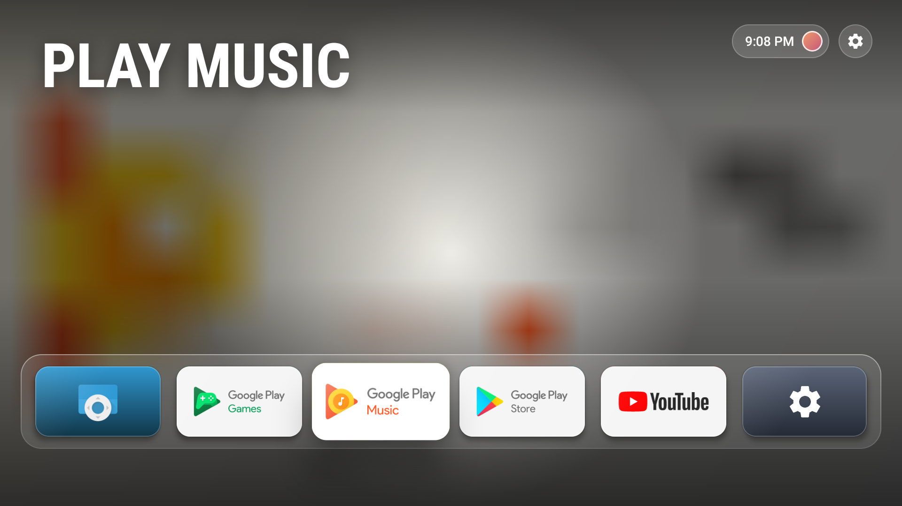
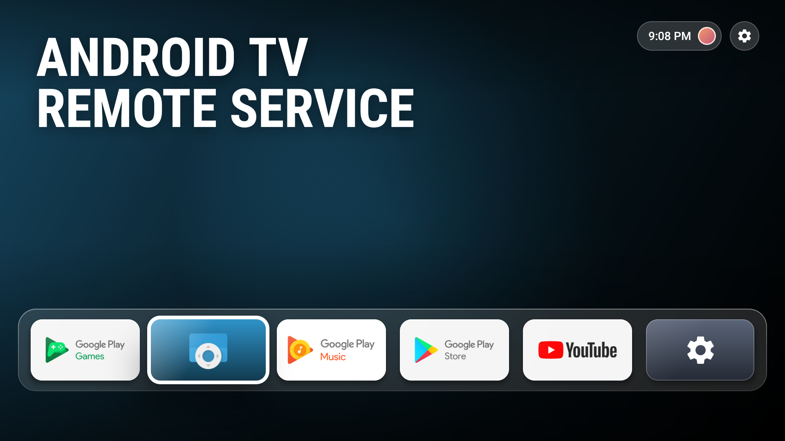

> [!WARNING]
> **Early preview.** Shelf is still in active development and testing. Things may change between versions. Feel free to try it, and expect the occasional rough edge.

<h1 align="center">Shelf</h1>

<p align="center">
  <b>The Apple TV look, on your Android TV.</b><br>
  A tvOS-inspired home screen with a frosted-glass dock, full-screen artwork and zero clutter.
</p>

<p align="center">
  <a href="#install-in-under-a-minute"><b>Install</b></a> ·
  <a href="#features">Features</a> ·
  <a href="#make-the-home-button-open-shelf">Home button setup</a> ·
  <a href="#faq">FAQ</a>
</p>


---

## Your TV, without the noise

Most Android TV home screens are crowded with ads, rows of suggestions and things you never asked for. Shelf strips all that away.

Just your apps, sitting on a glass dock. Move between them and the whole screen comes alive with the colors of the app you're on. Clean, calm, and instantly familiar if you've ever used an Apple TV.



## Features

**🪟 Frosted-glass dock**
Your apps on a translucent shelf at the bottom of the screen, using each app's official TV artwork.

**🎨 A screen that follows you**
The background takes on the colors of whichever app you're on and fades smoothly as you move. The focused tile lifts, grows and catches the light.

**✋ Arrange it your way**
Hold OK on any app to open, move or hide it. Your layout is remembered.

| Long-press menu | Moving an app |
|---|---|
|  |  |

**📺 HDMI inputs, one click away**
Your game console, cable box or soundbar sits in a row right under the dock, with the names you gave them.

**⚙️ Make it yours**
Choose how many apps per row, a 12 or 24-hour clock, how strong the glass looks, and the backdrop style: blurred, sharp or plain color.


**🔄 Updates itself**
When a new version is out, an *Update available* button appears in the corner. One click and you're on the latest.

**🪶 Light and private**
No account, no ads, no tracking, no internet needed (except for checking updates). Works on Android TV 8.0 and newer, and stays smooth on older TVs.

## Install in under a minute

### With Downloader (easiest)

1. On your TV, install **Downloader** from the Google Play Store.
2. Open it and enter the code

   <h3><code>8100721</code></h3>

3. Allow Downloader to install apps when asked.
4. Hit **Install**. Done.

### Other ways

- **Direct link** (in Downloader or any TV browser):
  `https://github.com/dvir9032/tvOS-Launcher/releases/latest/download/ShelfLauncher.apk`
- **From the [Releases](../../releases/latest) page**
- **With ADB:** `adb install -r ShelfLauncher.apk`

## Make the Home button open Shelf

Press **Home** on your remote. If your TV asks which home screen to use, pick **Shelf** → **Always**. That's it.

### Sony Bravia and other TVs that don't ask

No computer needed:

1. Open **Shelf** from your TV's app list.
2. Select the orange **Set up Home button** pill at the top (currently labeled in Hebrew: *הגדר כפתור בית*).
3. Turn on **Shelf – כפתור הבית** in the list that opens.

From now on, Home takes you straight to Shelf. The orange pill disappears once it's set up.

<details>
<summary><b>Prefer ADB? Turn off the built-in launcher instead</b></summary>

1. On the TV: Settings → Device Preferences → About → click **Build** 7 times.
2. Settings → Device Preferences → Developer options → turn on **USB debugging** (and **Network debugging** if listed).
3. From a computer on the same network:

   ```
   adb connect <TV-IP>:5555
   adb shell cmd package resolve-activity --brief -a android.intent.action.MAIN -c android.intent.category.HOME
   ```

   The last line shows your current launcher, usually `com.google.android.tvlauncher/...`. Disable it (this doesn't delete it):

   ```
   adb shell pm disable-user --user 0 com.google.android.tvlauncher
   ```

To bring the original launcher back at any time:

```
adb shell pm enable com.google.android.tvlauncher
```

</details>

## FAQ

**Is it safe?**
Every version is built automatically from the code you see here, then installed and tested on an Android TV emulator before it's published. If a test fails, the version never goes out. You can follow every build under [Actions](../../actions).

**What does the Home button service do?**
It only notices when your TV's built-in launcher comes to the front and opens Shelf instead. It doesn't read anything on your screen.

**Can I go back to my old home screen?**
Anytime. Turn off *Shelf – כפתור הבית* in Accessibility settings, or uninstall Shelf. Nothing on your TV is changed permanently.

**Does it work on my TV?**
Shelf runs on Android TV 8.0 and newer. Every version is tested on an Android TV 10 emulator, and it runs on a Sony Bravia. The menus are in Hebrew for now.

**How do I update?**
Shelf tells you when there's a new version. You can also reinstall from the same Downloader code anytime; your layout and settings stay.

## Build it yourself

Open the project in [Android Studio](https://developer.android.com/studio) and run **Build → Build APK(s)**.

---

<sub>Shelf is an independent project inspired by the design of tvOS. It is not affiliated with, endorsed by, or connected to Apple or Google. tvOS and Apple TV are trademarks of Apple Inc. All app names and artwork shown belong to their owners.</sub>

<sub>[עברית](README.he.md)</sub>
