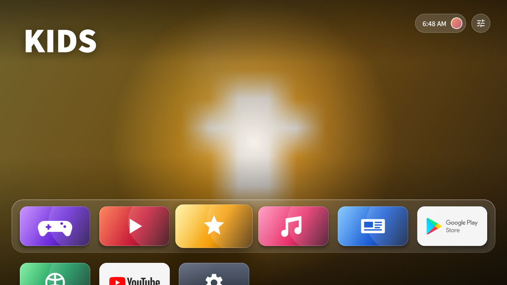
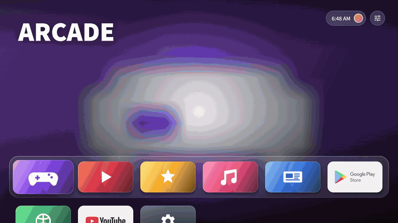
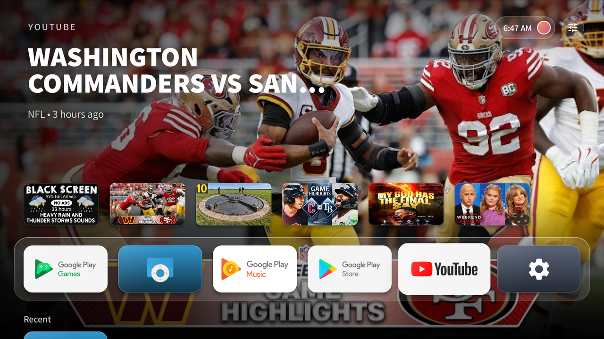
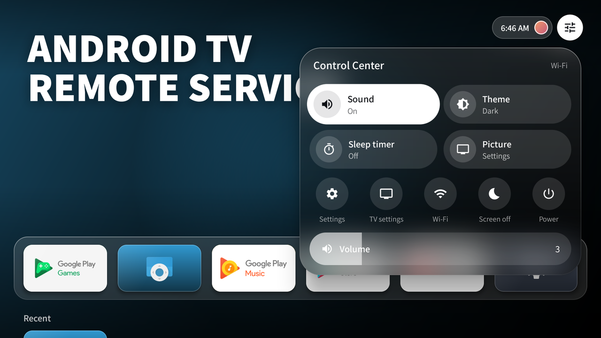
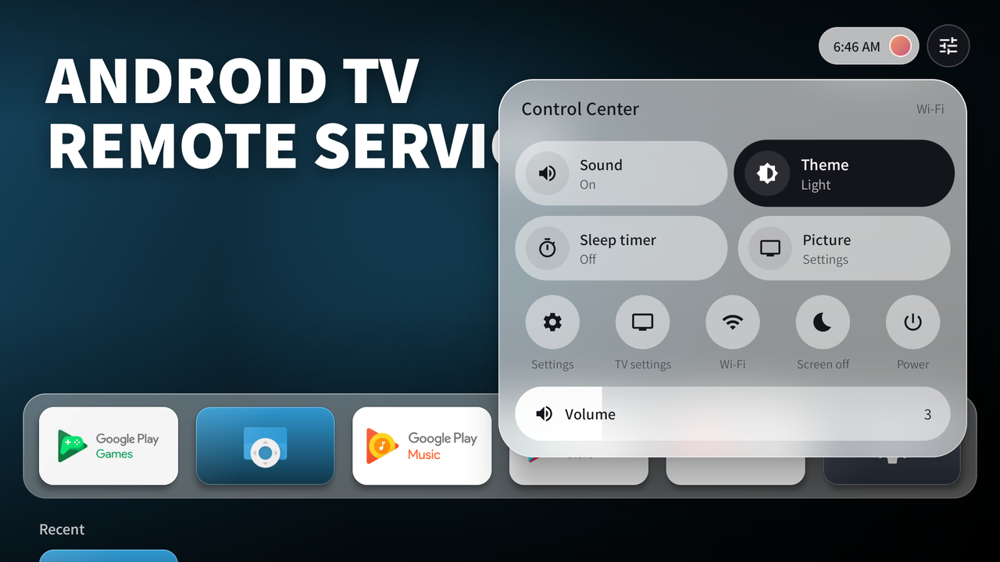
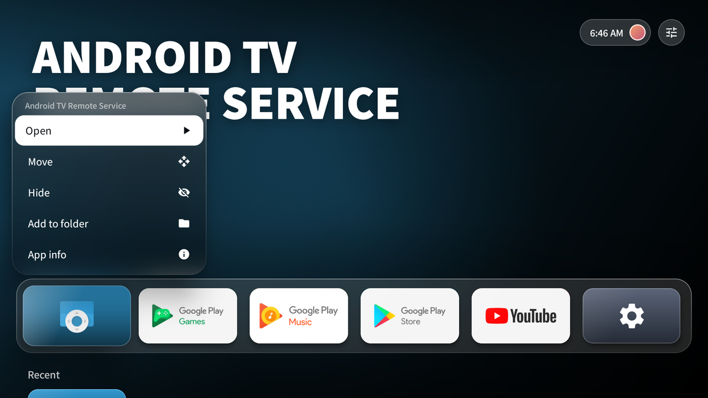
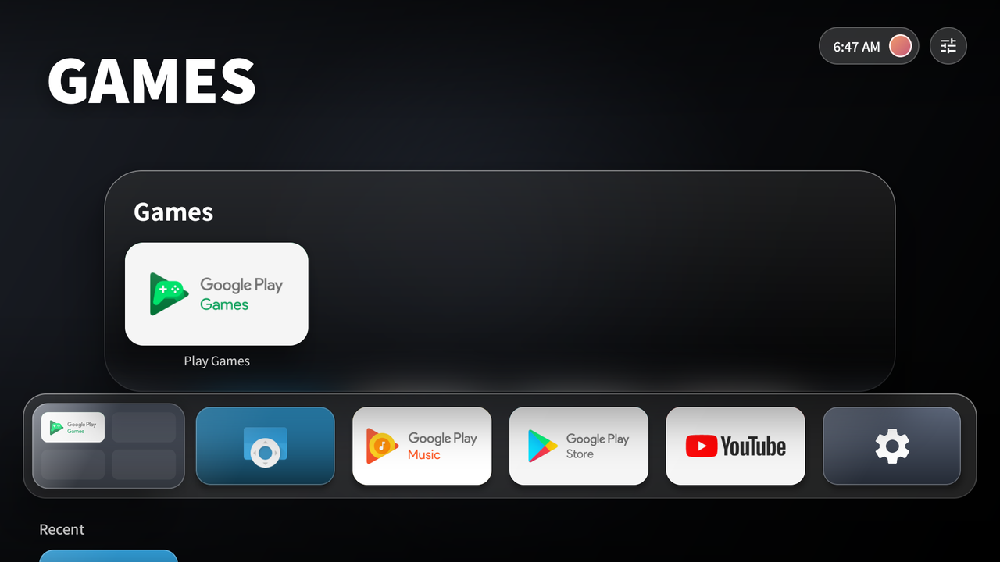
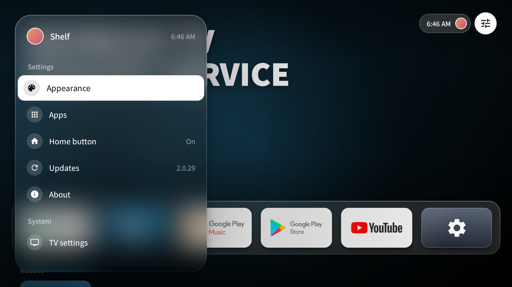
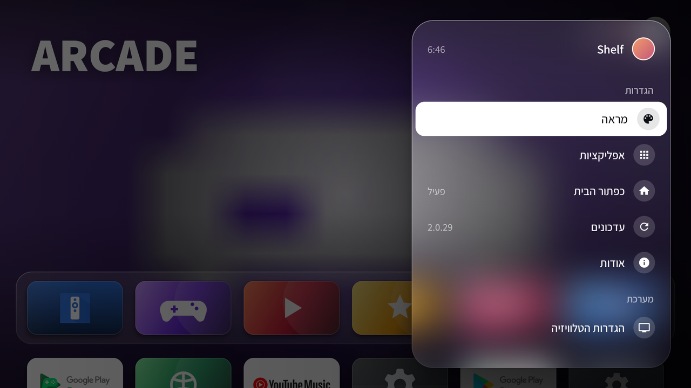

> [!WARNING]
> **Early preview.** Shelf is still in active development and testing. Things may change between versions. Feel free to try it, and expect the occasional rough edge.

<h1 align="center">Shelf</h1>

<p align="center">
  <b>The Apple TV look, on your Android TV.</b><br>
  A tvOS-inspired home screen with a frosted-glass dock, content from your apps, Control Center and zero clutter.
</p>

<p align="center">
  <a href="#install-in-under-a-minute"><b>Install</b></a> ·
  <a href="#features">Features</a> ·
  <a href="#make-the-home-button-open-shelf">Home button setup</a> ·
  <a href="#faq">FAQ</a>
</p>



---

## Your TV, without the noise

Most Android TV home screens are crowded with ads, rows of suggestions and things you never asked for. Shelf strips all that away.

Just your apps, sitting on a glass dock. Move between them and the whole screen comes alive with the colors and content of the app you're on. Clean, calm, and instantly familiar if you've ever used an Apple TV.



## Features

**🎬 Top shelf: content from your apps**
Land on YouTube, Netflix or any app that publishes to the Android TV home screen, and its shows and videos fill the screen, with the title and a short description. They rotate on their own; press Up for the page dots, Left / Right to browse, OK to start watching.



**🪟 Frosted glass everywhere**
The dock, menus, Control Center and Settings are frosted glass that shows a blurred view of what's behind them, even on older TVs that can't blur live.

**🎛️ Control Center**
One button at the top right: sound, theme, sleep timer, picture settings, Wi-Fi, screen off, the TV's power menu and a volume bar. Plus an Inputs button for your HDMI devices.

| Dark | Light |
|---|---|
|  |  |

**🌗 Dark, Light or Auto**
Dark glass with white text, bright glass with dark text, or Auto, which turns dark from 7 pm to 6 am.

**✋ Arrange it your way**
Hold OK on any app for a menu right above it: open, move, move to start, hide, add to folder, app info or uninstall. Your layout is remembered.

| App menu | Folders |
|---|---|
|  |  |

**📁 Folders**
Group apps into ready-made folders (Games, Movies & TV, Music, Kids, Tools) with no typing, or rename them with the on-screen keyboard.

**🕘 Recent**
The apps you opened last, in a row that appears when you press Down.

**⚙️ Settings, tvOS style**
A floating glass sidebar: theme, apps per row, 12 or 24-hour clock, glass strength, backdrop style, app content, hidden apps and more. In English, or in Hebrew (right to left) when your TV is set to Hebrew.

| English | עברית |
|---|---|
|  |  |

**🔄 Updates itself**
When a new version is out, an *Update available* button appears in the corner. One click and you're on the latest.

**🪶 Light and private**
No account, no ads, no tracking. Works on Android TV 8.0 and newer, and stays smooth on older TVs.

## Install in under a minute

### With Downloader (easiest)

1. On your TV, install **Downloader** from the Google Play Store.
2. Open it and enter the code

   <h3><code>8100721</code></h3>

3. Allow Downloader to install apps when asked.
4. Hit **Install**. Done.

> [!IMPORTANT]
> **"App blocked to protect your device" from Google Play Protect?**
> Google automatically blocks apps installed from outside the Play Store when they include an accessibility service, which Shelf uses to make the Home button work on TVs like Sony Bravia. It's a blanket rule based on that permission, not a sign that anything is wrong with Shelf.
>
> To install anyway:
> 1. Open the **Google Play Store** on your TV → your profile or Settings → **Play Protect** → ⚙️ → turn off **Scan apps with Play Protect**. (The exact path varies a little between TVs.)
> 2. Install Shelf again from Downloader.
> 3. **Turn Play Protect back on.** It keeps protecting you from other apps.

> [!TIP]
> In Downloader, enter the code on the **Home** screen (☰ → Home), in the field *Enter a URL, search term, or short code*, not in the Browser tab.

### Other ways

- **Direct link** (in Downloader or any TV browser):
  `https://github.com/dvir9032/tvOS-Launcher/releases/latest/download/ShelfLauncher.apk`
- **From the [Releases](../../releases/latest) page**
- **With ADB:** `adb install -r ShelfLauncher.apk`

## Make the Home button open Shelf

Press **Home** on your remote. If your TV asks which home screen to use, pick **Shelf** → **Always**. That's it.

### Sony Bravia and other TVs that don't ask

No computer needed:

1. Open **Shelf** from your TV's app list.
2. Select the orange **Set up Home button** pill at the top.
3. Turn on **Shelf – Home button** in the list that opens.

From now on, Home takes you straight to Shelf. The orange pill disappears once it's set up.

<details>
<summary><b>Prefer ADB? Turn off the built-in launcher instead</b></summary>

1. On the TV: Settings → Device Preferences → About → click **Build** 7 times.
2. Settings → Device Preferences → Developer options → turn on **USB debugging** (and **Network debugging** if listed).
3. From a computer on the same network:

   ```
   adb connect <TV-IP>:5555
   adb shell cmd package resolve-activity --brief -a android.intent.action.MAIN -c android.intent.category.HOME
   ```

   The last line shows your current launcher, usually `com.google.android.tvlauncher/...`. Disable it (this doesn't delete it):

   ```
   adb shell pm disable-user --user 0 com.google.android.tvlauncher
   ```

To bring the original launcher back at any time:

```
adb shell pm enable com.google.android.tvlauncher
```

</details>

## FAQ

**Is it safe?**
Every version is built automatically from the code you see here, then installed and tested on an Android TV emulator before it's published. If a test fails, the version never goes out. You can follow every build under [Actions](../../actions).

**What does the Home button service do?**
It only notices when your TV's built-in launcher comes to the front and opens Shelf instead. It doesn't read anything on your screen.

**Can I go back to my old home screen?**
Anytime. Turn off *Shelf – Home button* in Accessibility settings, or uninstall Shelf. Nothing on your TV is changed permanently.

**Does it work on my TV?**
Shelf runs on Android TV 8.0 and newer. Every version is tested on an Android TV 10 emulator, and it runs on a Sony Bravia. Menus are in English, or in Hebrew when your TV is set to Hebrew.

**What does Shelf ask permission for?**
Each one is optional and asked only when needed:
- *TV listings*: to show content from your apps in the top shelf.
- *Shelf – Home button* (accessibility): so the Home button opens Shelf, and to open the TV's power menu.
- *Lock the screen* (device admin): only for "Screen off" and the sleep timer.

**How do I update?**
Shelf tells you when there's a new version. You can also reinstall from the same Downloader code anytime; your layout and settings stay.

## Build it yourself

Open the project in [Android Studio](https://developer.android.com/studio) and run **Build → Build APK(s)**.

---

<sub>Shelf is an independent project inspired by the design of tvOS. It is not affiliated with, endorsed by, or connected to Apple or Google. tvOS and Apple TV are trademarks of Apple Inc. All app names and artwork shown belong to their owners.</sub>

<sub>Control Center, folders, the Recent row and the themes were inspired by [Lumen](https://github.com/ammar027/lumen-webos) for LG webOS (MIT).</sub>

<sub>Shelf uses the [Assistant](https://fonts.google.com/specimen/Assistant) typeface by Adobe Systems Inc. and Ben Nathan, under the SIL Open Font License ([license](docs/FONT-LICENSE-Assistant.txt)).</sub>

<sub>[עברית](README.he.md)</sub>
